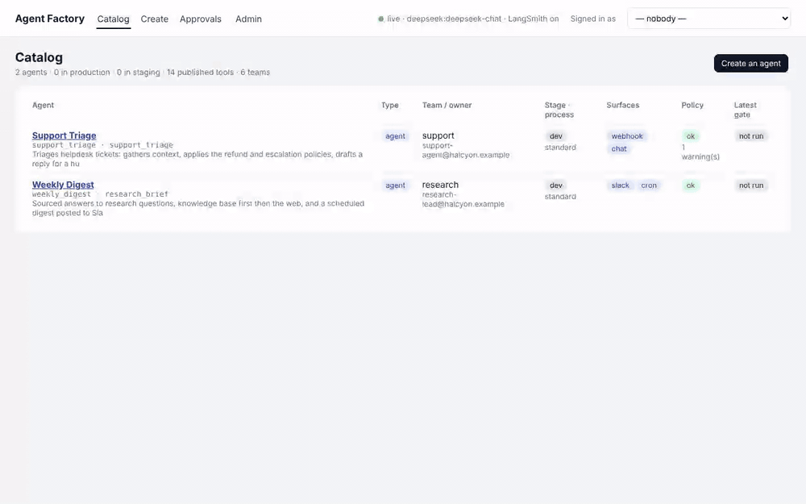
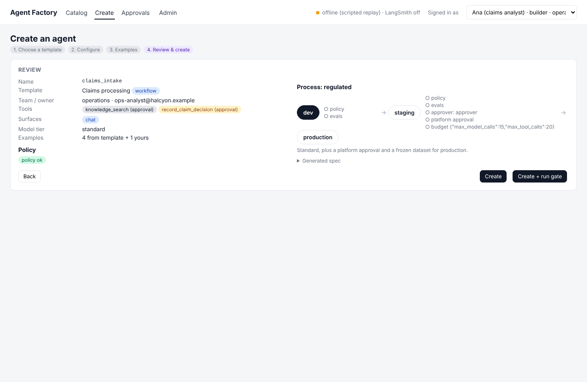
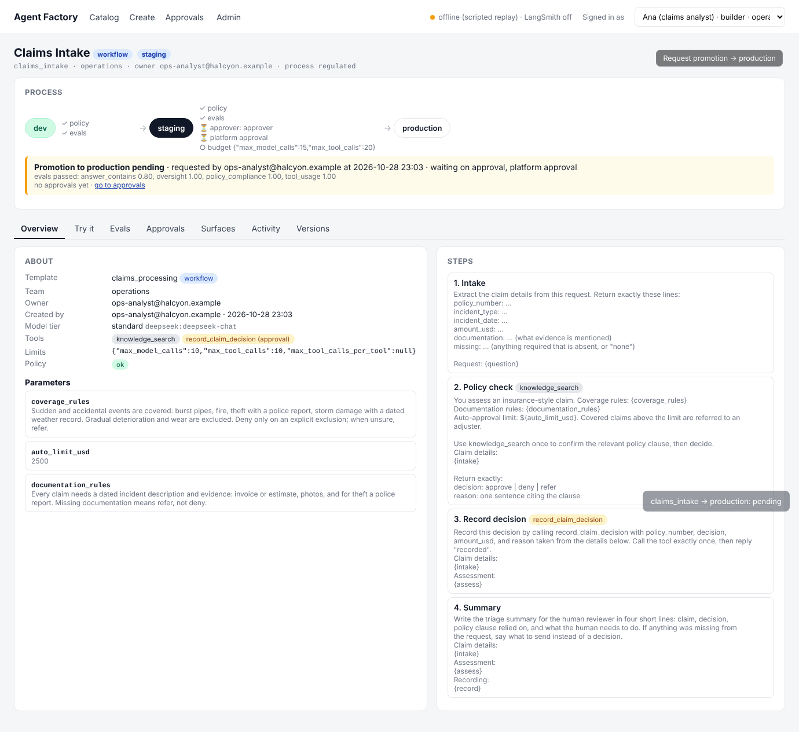
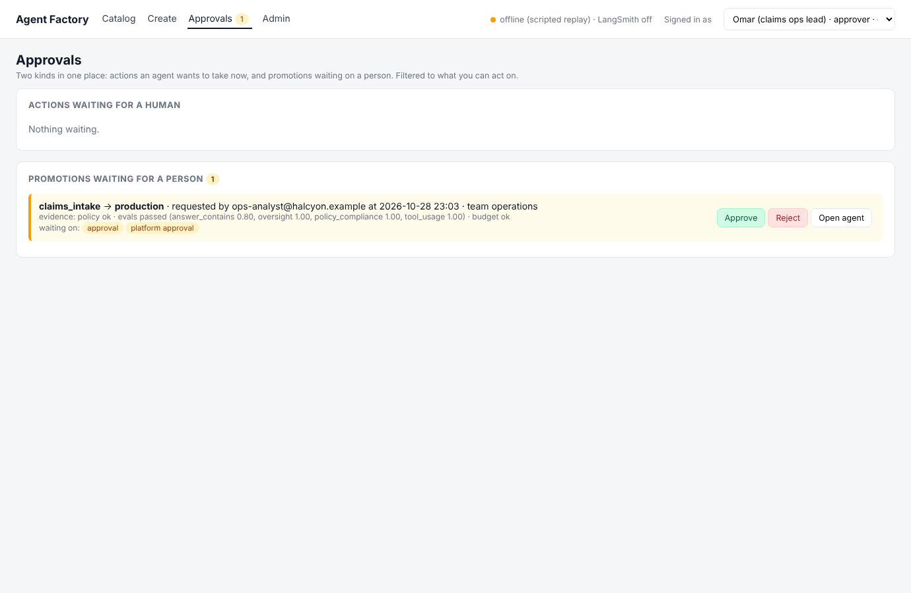
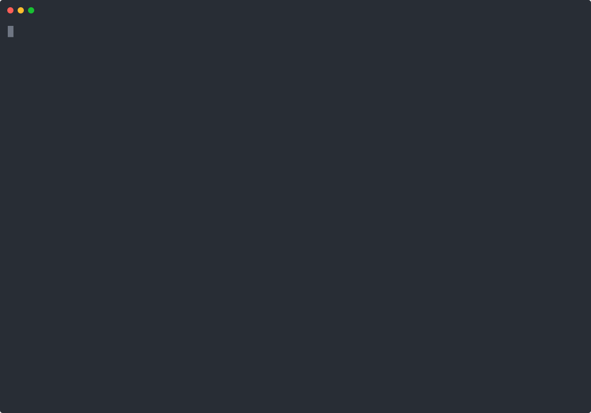

# Agent Factory

**The operating-model layer for running many agents on LangChain.** The organization defines what an agent is and how it reaches production. Teams create agents from those definitions in a console. The factory generates the spec, enforces policy, builds on LangGraph and Deep Agents, gates promotion through a named process, opens surfaces, and keeps the catalog. LangSmith does the tracing, evaluation, versioning, and deployment underneath.

> Independent demonstration by Chase ([@mrcloudchase](https://github.com/mrcloudchase)). Not an official LangChain product. The customer, Halcyon, and its people are fictional.



## The problem

Three teams build three agents with three prompts, three tool sets, and three ideas of "working." Leadership asks what runs, who owns it, what it can do, and how anyone knows it works. Nobody can answer. LangChain's own lifecycle guidance names the fix: shared infrastructure and governance so teams move from build to test to deploy to monitor the same way. LangSmith Fleet does this for no-code creators. This project is the equivalent for the organization's code-first agents, and it is shaped like what a Professional Services engagement would leave behind.

## What the organization owns

Everything under `org/`, edited by the platform team, shown in the console:

| Object | What it holds |
|---|---|
| **Archetypes** | `workflow`: fixed steps with the model inside them, compiles to LangGraph. `agent`: the model decides, compiles to Deep Agents |
| **Templates** | archetype, parameters a user fills, default and allowed tools, required approvals, allowed surfaces, evaluators and thresholds, the process, starter examples with offline trajectories |
| **Tool catalog** | published tools with risk, scope (acts as a person or as the org), allowed teams, approval requirement |
| **Processes** | stages and gates as data: `standard` (policy and evals to staging; evals plus a team approver to production) and `regulated` (plus a platform approver and a frozen dataset) |
| **Teams, users, model tiers, policy settings** | who may build and approve for which team; tiers with pinned params; rule severities and ceilings |

Teams create **instances**: a template plus parameters. The spec is generated, never hand-written.

## What a team experiences



1. **Choose a template**, grouped Workflow and Agent. Each card says where it pauses for a human and which process it follows.
2. **Configure**: plain-language parameters, tools from the catalog already filtered to the team, surfaces from the allowed list.
3. **Examples**: a few request and expected-answer pairs. They join the template's starter cases as the eval set.
4. **Review**: the generated spec, policy inline, the process drawn. Create is disabled until policy passes.
5. **Agent page**: a pipeline bar with every gate's state; Try it with inline approvals; Evals with history and LangSmith links; Approvals; Surfaces; Activity; Versions.
6. **Request promotion**: automatic gates run; human gates go to the approvers' inbox with the evidence attached.





## Seven templates, no integrations required

| Template | Type | Team | Pauses for a human | Process |
|---|---|---|---|---|
| Claims processing | workflow | operations | recording the decision | regulated |
| Document review | workflow | legal | none | standard |
| Support triage | agent | support | issuing a refund | standard |
| Research brief | agent | research | none; posts a digest on a schedule | standard |
| Engineering assistant | agent | engineering | posting a PR comment | standard |
| Judge | agent | any | none; usable as an eval judge | standard |
| Meeting actions | agent | any | none | standard |

## Ten-minute tour, no keys needed

```bash
uv venv && uv pip install -e ".[dev]" && cp .env.example .env
factory templates                      # what the org offers
factory tools                          # what engineering has published
factory new claims_intake --template claims_processing --owner ops-analyst@halcyon.example
factory validate claims_intake         # policy, before anything else
factory run claims_intake "Claim: policy P-1007, stolen laptop from a locked car on 2026-09-28, amount $3,100, police report attached."
factory eval claims_intake             # the gate
factory promote claims_intake          # dev -> staging: policy + evals
factory promote claims_intake          # staging -> production: pending on two approvals
factory approve claims_intake <id> --as ops-lead@halcyon.example
factory approve claims_intake <id> --as platform-lead@halcyon.example
factory list
langgraph dev                          # then open http://localhost:2024/console
```



Offline mode replays trajectories recorded next to each template example, so every command and the whole console run with no secrets. Add `DEEPSEEK_API_KEY` and `LANGSMITH_API_KEY` to `.env` and the same gates run against the real model with experiments, traces, and Context Hub commits in your LangSmith workspace.

## What it leans on, by name

LangSmith Observability for traces, Evaluation for experiments, Context Hub for versions, Deployment and the Agent Server for runtime and surfaces, Studio and the Agent Inbox for developer and approver views beyond the console, Fleet for creators outside the factory, the LLM Gateway as the production form of model tiers, Engine as the production form of the harvest loop, Sandboxes for any template that executes code. See [docs/langchain-product-map.md](docs/langchain-product-map.md).

## Repository

```
org/                 the organization's definitions (teams, models, policy, tools, processes, templates)
agents/<name>/       instances: instance.yaml, spec.generated.yaml, evals/
src/factory/
  core/              registry, template, instance, spec, policy
  build/             agent harness (Deep Agents), workflow compiler (LangGraph), middleware, models
  evals/             runner, evaluators, gate
  lifecycle/         create, promote, ledger, feedback, catalog
  surfaces/          webhook, mcp, cron, slack, resolve
  console/           api, ui, auth, app (mounted in the Agent Server)
  cli/  tools/  graphs.py
tests/  docs/  demo/  .github/workflows/ci.yml
```

## Read next

- [Architecture](docs/architecture.md)
- [Tradeoffs and limits](docs/tradeoffs-and-limits.md)
- [LangChain product map](docs/langchain-product-map.md)
- [Design proposal](docs/design-proposal.md)
- [Demo script](docs/demo-script.md)
