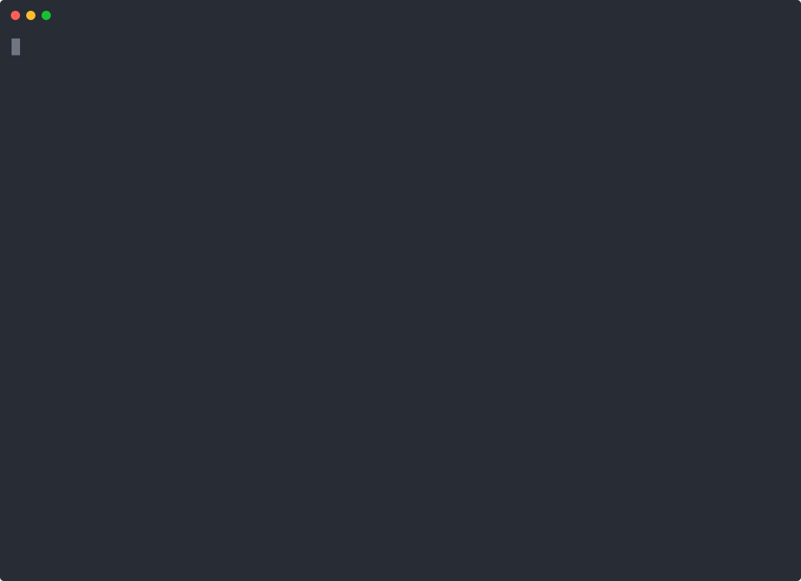

# Agent Factory

**A platform layer on LangChain that lets an organization decide what an agent is and how it reaches production, so teams can build their own agents and the org can still trust them.**

The platform team publishes templates, a tool catalog, and paths to production as code. Builders on each team create agents from those templates in a console, try them, and promote them. Every promotion runs an eval gate in LangSmith, the template's process decides who must approve, and bad answers from real runs become new eval cases. Nothing is pre-seeded: the demo starts with an empty catalog and builds three agents.

> Independent demonstration by Chase ([@mrcloudchase](https://github.com/mrcloudchase)), built to show the work of a LangChain Deployed Engineer in Professional Services. Not an official LangChain product and not a customer deployment. The company (Halcyon) and its people are fictional.


*Recorded live against DeepSeek with LangSmith tracing, evaluation and Context Hub on; the GIF plays at 3x. [MP4 at 1.5x](demo/walkthrough.mp4). Every screen is in [demo/shots](demo/shots).*

## The story in the recording

| Act | Who | What happens | Screens |
|---|---|---|---|
| 1. The org sets the rules | Priya, platform lead | Three templates, a 14-tool catalog, two processes, all defined in `org/` and checked in CI. The console only reflects them. | [templates](demo/shots/02-org-templates.png), [tools](demo/shots/03-org-tools.png), [processes](demo/shots/04-org-processes.png) |
| 2. Teams build their own agents | Dev (support), Kai (engineering), Noor (research) | Each picks a template, sets parameters, reviews policy, creates. The support agent pauses before refunding; the coding agent reads the failing test and diff; the research workflow pulls live papers, discussion and PyPI releases. | [review](demo/shots/05-create-support-review.png), [refund pause](demo/shots/06-support-paused-for-refund.png), [coding](demo/shots/08-coding-answer.png), [research](demo/shots/10-research-answer.png) |
| 3. Policy refuses what the org disallows | Rae, research lead | Tries the support template; refused before anything is written. | [refused](demo/shots/11-create-refused.png) |
| 4. The gate blocks a bad change | Dev | Rewrites the refund policy to send every refund to tier 2. The live gate shows the agent no longer refunds a duplicate charge, so promotion is blocked. Dev reverts; it passes. | [blocked](demo/shots/15-support-gate-blocked.png) |
| 5. People approve what the process requires | Sam, then Priya | The support template is `regulated`: a team approver and a platform approver, never the requester, never the same person twice. Production saves a baseline and pushes a Context Hub version. | [approvals](demo/shots/17-approvals-sam.png), [production](demo/shots/18-support-production.png) |
| 6. Production teaches the gate | Rae, then Noor | Rae flags a research answer (recorded as LangSmith feedback). Noor writes what a correct answer must contain; the gate runs it on every future promotion. | [flagged](demo/shots/20-research-pending-case.png), [dataset](demo/shots/21-research-dataset.png) |

The platform team's side is code, not forms. This recording shows `org/` and `factory check` catching a pull request that removes the approval on refunds:



## Why this is Professional Services work

LangChain's products cover one agent's lifecycle well: Deep Agents and LangGraph to build, LangSmith to trace and evaluate, Context Hub to version, the Agent Server to deploy. Fleet covers non-technical creators. What a customer still has to decide is organizational, and different at every company:

- which tools each team may use, and which actions always pause for a person;
- what "working" means for each kind of agent, and what an agent must pass before production;
- who approves, by role, without anyone approving their own work;
- where agents run (chat, webhook, MCP, schedule) and as whom;
- how bad answers in production get back into the tests.

That layer is what a deployed engineer leaves behind so adoption keeps going after the engagement ends: the platform team owns a small set of templates and processes; every other team ships agents on them without waiting for the platform team. Fleet serves the org's no-code creators; this serves its code-first agents under one policy and one path to production.

## How it uses LangChain

| Product | Used for |
|---|---|
| Deep Agents | Agent templates build on `create_deep_agent`; sensitive tools use `interrupt_on` so they pause for a person |
| LangGraph | Workflow templates compile to a `StateGraph` of fixed steps; one `factory` graph serves every agent |
| LangChain middleware | Every agent and step gets call limits, a tool allowlist, and an audit line per tool call |
| Agent Server (`langgraph dev` / LangSmith Deployment) | One assistant per agent; the console and webhook are custom routes on the same server; `/mcp` for the coding agent; crons for the research brief |
| LangSmith Evaluation | Each agent's dataset is synced; every gate is an experiment with a link; thresholds come from the template, the baseline from production |
| LangSmith Observability | Every run carries agent, surface and user metadata; flags become feedback on the run |
| Context Hub | Each promotion pushes the agent's instructions and config, tagged with the stage |

See [docs/langchain-product-map.md](docs/langchain-product-map.md) for every product, what a customer still builds around it, and where this repo touches it.

## Run it

Offline needs no keys: models replay recorded trajectories and research tools replay recorded HTTP responses.

```bash
uv venv && uv pip install -e ".[dev]"
cp .env.example .env              # leave keys empty for offline
uv run langgraph dev              # Agent Server + console on :2024
open http://localhost:2024/console
```

Pick a persona in the top right, create agents from the templates, and use the template's example questions in Try it (offline mode only replays those). Live mode needs `DEEPSEEK_API_KEY` (or change `org/models.yaml` to another provider) and, for experiments, feedback and Context Hub, `LANGSMITH_API_KEY`. Keys go in `.env`, which is gitignored.

The same lifecycle from a terminal:

```bash
uv run factory check                                   # what CI runs on org/
uv run factory new billing_support --template support_agent --as dev@halcyon.example
uv run factory run billing_support "Triage ticket T-1001" --approve
uv run factory promote billing_support --as dev@halcyon.example      # staging
uv run factory promote billing_support --as dev@halcyon.example      # waits on approvals
uv run factory approve <request-id> --as sam@halcyon.example
uv run factory approve <request-id> --as priya@halcyon.example
```

To reproduce the recordings: `scripts/platform_demo.sh` (asciinema) and `scripts/walkthrough.js` (Playwright, against a server with no agents).

## Repository

```
org/                      platform-owned, changed by pull request, checked by `factory check`
  teams.yaml              teams and people with roles (platform, builder, approver, viewer)
  models.yaml             model tiers
  tools.yaml              the tool catalog: owner, teams, sensitive, acts as user
  processes/              paths to production: stages, checks, approvals
  templates/<key>/        template.yaml, instructions.md, steps.yaml (workflows), examples.jsonl
agents/                   created by builders through the console (empty in git)
src/factory/
  org.py templates.py     load and cross-check org/
  agents.py spec.py       an agent's choices, and the spec materialized from template + choices
  policy.py               rules every agent must satisfy before it is written
  build/                  Deep Agents and LangGraph builders, org middleware, offline models
  evals/                  evaluators, runner, the gate (LangSmith experiments)
  lifecycle/              create, promotion and ledger, feedback, catalog
  server/                 console API, webhook, the console page; mounted in the Agent Server
  tools/                  helpdesk, repo and CI, live research sources, knowledge base
data/                     fixture helpdesk, CI record, knowledge base, recorded HTTP responses
tests/                    34 offline tests; CI runs `factory check`, ruff and pytest
```

## Read next

- [docs/architecture.md](docs/architecture.md): how a template becomes a running agent, and how promotion and feedback work.
- [docs/demo-script.md](docs/demo-script.md): the walkthrough as a talk track.
- [docs/tradeoffs-and-limits.md](docs/tradeoffs-and-limits.md): what is simulated, what a real engagement would change, and what live testing showed.
- [docs/langchain-product-map.md](docs/langchain-product-map.md): the LangChain products and the gaps around them.
