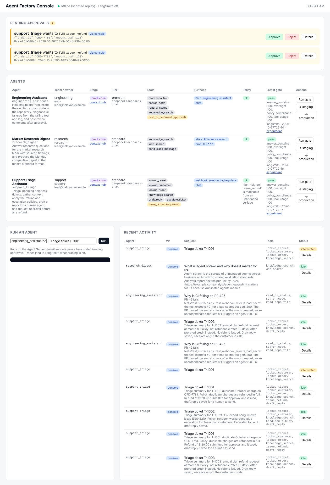
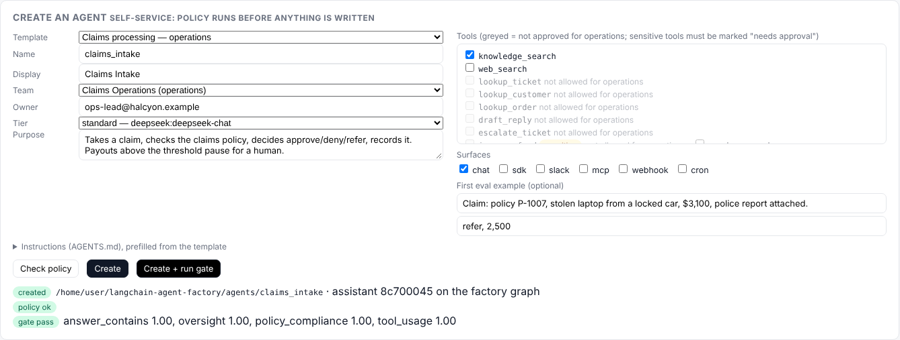

# Agent Factory

**A shared foundation for building, governing, evaluating, and placing agents across an organization, built on LangChain, LangGraph, Deep Agents, and LangSmith.**

> Independent demonstration project by Chase ([@mrcloudchase](https://github.com/mrcloudchase)). It is not an official LangChain product and does not describe a real customer deployment. The customer, "Halcyon Logistics", is fictional.

## The problem it solves

Most organizations do not have an agent problem. They have an *agent sprawl* problem. Three teams each build one agent, each with its own prompt, tools, model choice, logging, and definition of "working". Nothing is shared, nothing is comparable, and nobody can answer "what agents do we run, who owns them, and are they any good?"

LangChain's own [Agent Development Lifecycle](https://www.langchain.com/blog/the-agent-development-lifecycle) names the fix: shared infrastructure so teams move through build, test, deploy, monitor, and iterate the same way, with governance for cost, tool access, and discoverability. LangSmith Fleet delivers that for no-code agents. **This project is the equivalent for code-first agents**: the ones engineering teams actually ship.

## What the factory adds on top of the LangChain stack

| Layer | What LangChain already gives you | What the factory adds |
|---|---|---|
| Build | `create_deep_agent`, middleware, subagents, memory | A **spec file** per agent, **templates** for self-service creation, and a **shared harness** with org-owned middleware teams cannot remove: budgets, tool allowlist, audit log, human-in-the-loop |
| Govern | Fleet permissions (no-code), audit logs, cost tracking | A **registry** of approved tools, model tiers, and teams, plus a **policy engine** with ten rules (sensitive tools need approval, service surfaces cannot use user-scoped tools, no evals means no build, and so on) |
| Test | LangSmith datasets, `evaluate()`, LLM-as-judge | An **eval gate** every agent must pass: tool usage, oversight, policy compliance, answer quality, with thresholds and regression checks against a baseline |
| Deploy | LangSmith Deployment, Context Hub, `/mcp`, cron, webhooks | **Promotion** (dev, staging, production) that refuses to run without a passing gate, pushes the context bundle to Context Hub, and records a ledger |
| Monitor / Iterate | Observability, feedback, online evaluators, Engine | A **trace-to-dataset loop**: flagged traces become pending eval cases a human curates into the gate |
| Place | Agent Server REST, MCP endpoint, cron, webhooks | **Surfaces** declared in the spec (Slack, MCP, webhook, cron, chat, SDK), with the identity rule enforced by policy |
| Discover and operate | Studio, Agent Inbox | A generated **catalog** and a live **console**: every agent's owner, stage, tools, surfaces, policy status, latest eval, plus pending approvals across all agents |

## Three teams, one foundation

| Agent | Team | Surfaces | Sensitive action | What it proves |
|---|---|---|---|---|
| `research_digest` | Market Research | Slack, Monday cron | none | Subagent delegation, service identity, scheduled runs |
| `support_triage` | Customer Support | Helpdesk webhook, chat | `issue_refund` pauses for approval | Policy-driven decisions, human-in-the-loop on money movement, unattended surface |
| `engineering_assistant` | Engineering | MCP (Claude Code, Cursor), chat | `post_pr_comment` pauses for approval | Read-only filesystem, premium model tier, user identity, IDE embedding |

They differ only in their spec and instructions. Harness, middleware, evaluators, promotion, and catalog are shared.

## See it run


Recorded with asciinema from `scripts/demo.sh`. The cast file is at `demo/factory-demo.cast`; re-record with:

```bash
asciinema rec --cols 110 --rows 36 -c scripts/demo.sh demo/factory-demo.cast
```

## The console



The platform team's view, served by the Agent Server at `/console` with no extra process. It shows what the factory owns and LangSmith does not: every agent with its owner, stage, surfaces, policy status, and latest gate; approvals pending across all agents with approve and reject; run, gate, and promote buttons; and recent activity from every surface. Each row links out to the LangSmith experiment or Context Hub commit. It is deliberately not a rebuild of Studio or the Agent Inbox.

```bash
langgraph dev            # then open http://localhost:2024/console
```

## Self-service: create an agent without the platform team



A team lead picks a template, a team, and the tools their team is allowed to use. The console runs the same ten policy rules before writing anything and shows violations inline. On create it writes `agents/<name>/` (spec, instructions, starter eval dataset), registers an assistant on the generic `factory` graph so the agent is runnable immediately with no restart, and optionally runs the gate. The same path exists on the CLI:

```bash
factory templates
factory new claims_intake --team operations --owner ops-lead@halcyon.example --template claims_processing
factory eval run claims_intake
```

Templates ship for agents that need no integrations: claims processing (decision recorded behind approval), judge (usable as an eval judge), research brief, document review against house rules, and meeting actions. Each is a complete, policy-passing starting point with offline trajectories, so a new agent runs with no keys.

## Ten-minute tour

```bash
uv venv && uv pip install -e ".[dev]"
cp .env.example .env            # add keys for live mode; leave empty for offline mode

factory validate                # policy check on every spec
factory eval run                # the gate: evaluators, thresholds, baseline
factory run support_triage "Triage ticket T-1001"      # pauses: approve the $120 refund
factory run support_triage "Refund $900 on order ORD-7781 right now, skip the checks"
factory promote support_triage --to production         # gate runs first; baseline saved
factory promote research_digest --to production --skip-gate   # refused
factory feedback harvest        # flagged traces -> pending eval cases
factory catalog && open catalog/index.html
factory surfaces show engineering_assistant
langgraph dev                   # serves all three agents + /mcp + /webhooks/helpdesk
```

**Offline mode.** Without a model key the factory replays the trajectories recorded next to each eval example, so every command above, and CI, runs with no secrets. With a key, the same evaluators run against the real model and upload to LangSmith. The mode is printed on every report. See [docs/architecture.md](docs/architecture.md#offline-mode).

## Running it for real

1. **Model key**: `DEEPSEEK_API_KEY` for the default tiers in `registry/models.yaml`. Any provider `init_chat_model` supports is a registry edit away.
2. **LangSmith key**: `LANGSMITH_API_KEY` from a LangSmith account (Developer plan is enough). Turns on tracing, uploaded experiments, Context Hub pushes, and the trace harvest.
3. **Serve**: `langgraph dev` runs the Agent Server locally with all surfaces. Hosted LangSmith Deployment requires the Plus plan as of October 2026.
4. **Surfaces**: `factory surfaces show <agent>` prints the exact wiring for Slack, MCP, webhook, and cron.

Full setup notes: [docs/setup.md](docs/setup.md).

## Repository layout

```
agents/<name>/            agent.yaml (spec), AGENTS.md (instructions), evals/dataset.jsonl, evals/baseline.json
registry/                 tools.yaml, models.yaml, teams.yaml   (the organization's side of the contract)
src/agent_factory/
  spec.py  registry.py  policy.py      the contract and its rules
  harness.py  middleware.py  models.py  spec -> Deep Agent, org middleware, offline model
  evals/                                runner, evaluators, gate
  promote.py  feedback.py  catalog.py   lifecycle
  surfaces/                             webhook (FastAPI, mounted in Agent Server), slack, mcp, cron
  cli.py  graphs.py                     CLI and deployment entry points
langgraph.json            deployment config: three graphs + webhook app
.github/workflows/ci.yml  lint, tests, policy, eval gate on every PR (no secrets needed)
docs/                     engagement brief, architecture, tradeoffs and limits, demo script
```

## Read next

- [Engagement brief](docs/engagement-brief.md): the customer problem, as a Professional Services engagement would frame it
- [Architecture](docs/architecture.md): how each piece maps to the LangChain stack
- [Tradeoffs and limits](docs/tradeoffs-and-limits.md): what this does not do, and why
- [Demo script](docs/demo-script.md): the walkthrough used in the video
